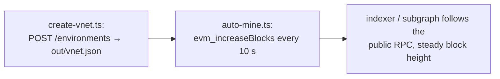

# 05 · Auto-mine for indexing

Virtual Environments mine on demand, so a block appears only when a transaction arrives. Indexers, subgraphs and block-polling apps expect a chain that keeps moving. These scripts create an environment, then mine an empty block every 10 seconds so anything pointed at its RPC sees a live chain.



## Run

The config is the shared repo-root `.env` (`TENDERLY_ACCESS_KEY` / `TENDERLY_ACCOUNT` / `TENDERLY_PROJECT`).

```bash
cd examples/05-auto-mine-indexing
npm install

npm run create        # 1) create the Environment, write out/vnet.json
npm run mine          # 2) long-running: +1 block every 10 s (Ctrl-C to stop)
npm run watch-state   # 3) optional: is state following live mainnet?
```

Settings (environment variables):

| Var | Default | Meaning |
| --- | --- | --- |
| `FORK_BLOCK` | `latest` | fork point for a plain `npm run create` (a State Sync fork always starts at latest) |
| `STATE_SYNC` | `false` | `true` creates the environment with State Sync, so unmodified state follows live mainnet |
| `MINE_INTERVAL_SECONDS` | `10` | seconds between ticks |
| `MINE_BLOCKS` | `1` | blocks mined per tick |
| `MINE_RPC_URL` / `WATCH_RPC_URL` | (none) | target an existing environment instead of `out/vnet.json` |
| `WATCH_INTERVAL_SECONDS` | `10` | seconds between state reads |

## State Sync check

State Sync is available on Tenderly's paid plan. It's set when the environment is created and can't be switched on or off later.

`watch-state.ts` polls two values that change on mainnet nearly every block, the Uniswap V3 USDC/WETH pool's `slot0` price and its WETH balance. It reads them from the environment's RPC and marks each tick `→ CHANGED` or `· frozen`.

- On a plain fork (`npm run create`) every tick is frozen, because state stays at the fork point.
- On a State Sync fork (`STATE_SYNC=true npm run create`) live mainnet state drifts in, so the values change. Keep `npm run mine` running in another terminal while you watch, because a State Sync environment catches up with mainnet each time it mines a block.

State Sync covers unmodified state only. Accounts you change with cheat codes or transactions keep your values.

`create-vnet.ts` turns State Sync on with `syncStateConfig` in the network config, on the environments endpoint `POST /api/v1/account/{account}/project/{project}/environments`. The snake_case `/api/public/v1/.../environments` endpoint, which the plain fork uses, ignores the setting.

## What you see

`npm run create` prints the Admin RPC for the miner, the Public RPC for the indexer, and the dashboard link. `npm run mine` logs one line per tick with the block number and timestamp, and the dashboard's block height climbs with it. On a plain fork the mined blocks are empty and carry wall-clock timestamps, so pollers that use `eth_getBlockByNumber` or `eth_subscribe` behave as they would against a public network.

Point your indexer at the Public RPC from `out/vnet.json` and keep the miner running while it indexes.
